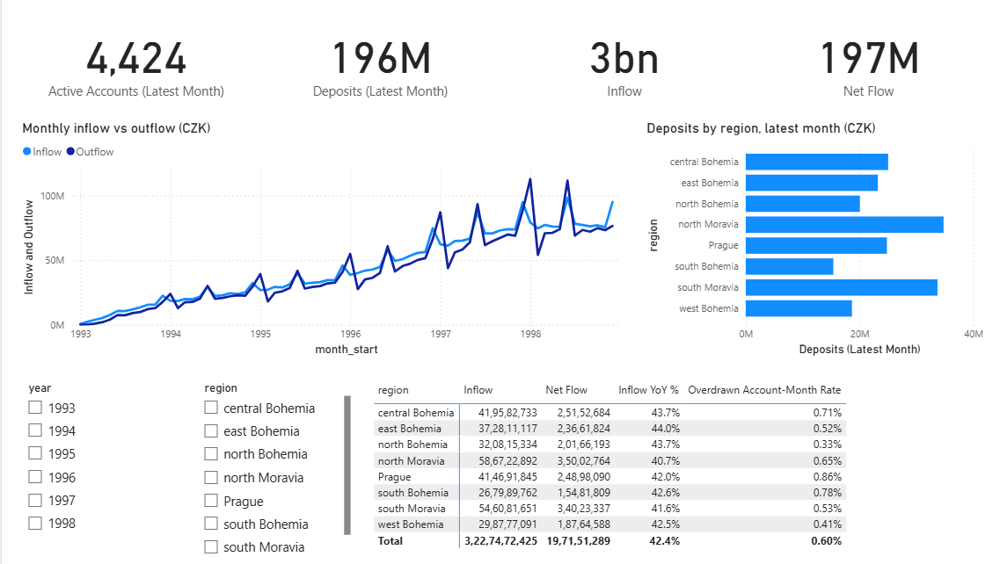
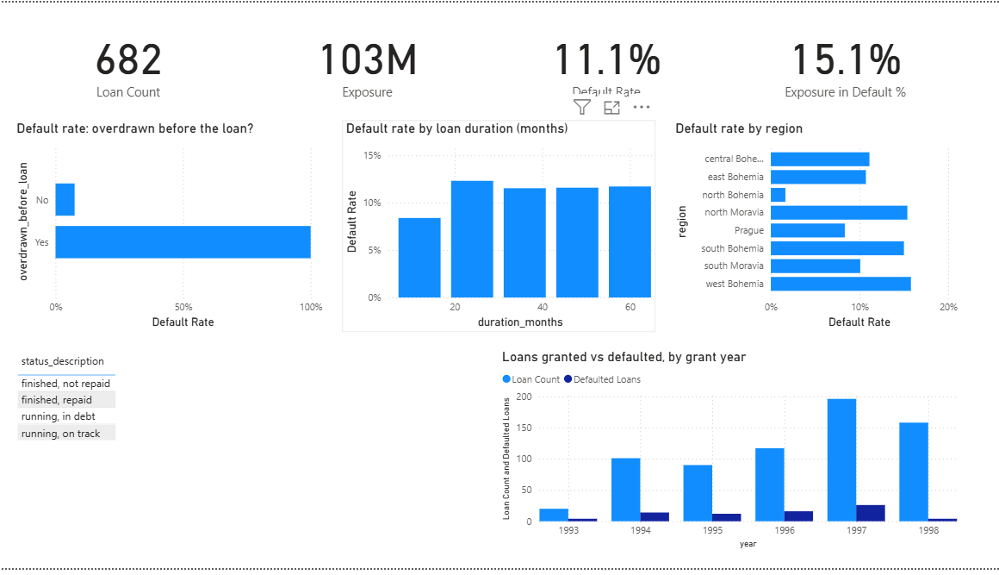
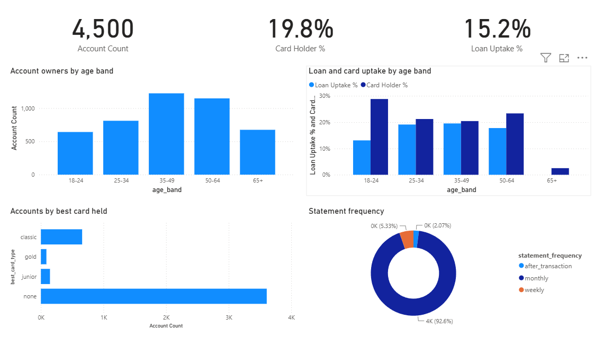

# Retail Bank Analytics: dbt + DuckDB warehouse and Power BI report

A tested analytics warehouse and a 3-page Power BI report built on **real, anonymised data from a Czech retail bank** (the PKDD'99 "Berka" dataset): 4,500 accounts, 5,369 clients, 1,056,320 transactions and 682 loans from 1993 to 1998.

[](https://github.com/vighnesh-shetty-vs/bank-analytics-dbt-powerbi/actions/workflows/dbt.yml)
**[Browse the dbt docs and lineage](https://vighnesh-shetty-vs.github.io/bank-analytics-dbt-powerbi/)** · [All 10 business questions with results](docs/business_questions.md)

## Key findings

- **The bank could have seen most defaults coming.** Using only transactions *before* each loan was granted:
  - All **27 loans** given to clients who had already been overdrawn **defaulted (100%)**, versus 7.5% for everyone else.
  - Clients whose balance dipped below 5,000 CZK in the 90 days before the loan defaulted at **59%**, versus 7.8% for the rest.
  - Clients in the least affordable quartile (loan payment as a share of monthly income) defaulted at **23.5%**, versus about 6–9% in the other three quartiles.
- **The local economy does not explain defaults.** Default rates are similar in low-, medium- and high-unemployment districts (10.1%, 12.8% and 10.6%). Account behaviour is the stronger signal.
- **Overall, 11.1% of loans default, holding 15.1% of the exposure.** Longer loans default slightly more often (12% vs 8% for 12-month loans) and are much larger.
- **Card holders keep higher balances.** In 1998, gold-card accounts averaged 71.9k CZK versus 33.4k CZK for accounts without a card. Yet cards carried only about 1% of outgoing money, and cash was still 75%.
- **Cash demand peaks in January, June and December**, at 25–49% above the monthly average. That matters for branch and ATM cash planning.
- **No loans went to owners aged 65+** (675 account owners). That is either a lending policy or a gap worth asking about.

## Architecture

```
data/raw/*.asc  ->  staging (8 views)  ->  intermediate (2 tables)  ->  marts (7 tables)  ->  exports/*.csv  ->  Power BI (.pbip)
  checksum-        types, Czech codes      point-in-time loan         star schema +            6 marts the        3 pages, 21 DAX
  verified         translated, dates       features, account-month    month x district KPIs    report imports     measures, RLS role
```

| Layer | Models | What happens |
|---|---|---|
| **Staging** | `stg_berka__*` (8) | Explicit types; YYMMDD integers to dates; gender decoded from Czech birth numbers (women have +50 on the month); Czech transaction codes (`PRIJEM`, `VYBER KARTOU`, `SANKC. UROK`…) translated to English; `'?'` placeholders turned into NULLs. |
| **Intermediate** | `int_loan_features_point_in_time`, `int_account_months` | Loan features built only from transactions **before** the grant date (see below); one row per account-month. |
| **Marts** | `dim_date`, `dim_districts`, `dim_clients`, `dim_accounts`, `fct_transactions`, `fct_loans`, `rpt_monthly_kpis` | Star schema for BI, and a month × district KPI table small enough to ship with the report. |

## Data quality: 55 tests, all passing in CI

- **Keys and relationships:** `unique`, `not_null` and `relationships` tests on every key; accepted values for every decoded code.
- **Daily balance reconciliation:** each day's balances must follow from the previous day's balance plus that day's net flow.
  - Writing this test surfaced 2 quirks in the source. The order of transactions within a day isn't recorded, so naive running totals break on half the rows.
  - Interest postings are also rounded differently from balances. 763,838 account-days reconcile exactly and 46,430 (5.7%) are off by at most 0.20 CZK. The test accepts any intra-day order and a 0.50 CZK tolerance.
- **No target leakage:** a test fails if any loan feature uses a transaction on or after the grant date. The dataset's own guide warns that, without this time constraint, "balance ever negative" separates good and bad loans perfectly.
- **Business rules:** loan amount = monthly payment × duration (true for all 682 loans); no transaction is dated before its account opened.

## Power BI report (`powerbi/BankAnalytics.pbip`)





Stored as a **PBIP project**, so the semantic model (TMDL) and the report (PBIR JSON) are plain-text files under version control.

| Page | Contents |
|---|---|
| **Overview** | KPI cards (active accounts, deposits, inflow, net flow); monthly inflow vs outflow; deposits by region; year and region slicers; a regional scorecard with inflow YoY % and overdraft rate |
| **Loan Risk** | Loans, exposure, default rate and exposure in default; default rate by "overdrawn before loan", by loan duration and by region; portfolio by status; loans vs defaults by grant year |
| **Customers** | Accounts, card holder % and loan uptake %; owners by age band; loan and card uptake by age band; accounts by card type; statement frequency |

**Model:**
- **Tables:** a star schema of 6 tables, with a marked date table and 6 one-to-many relationships.
- **DAX:** 21 measures, including latest-month semi-additive balances (`VAR LastMonth = MAX(...)`), `SAMEPERIODLASTYEAR` time intelligence and `DIVIDE`-safe ratios.
- **Security:** a row-level-security role, *Regional Manager – Prague*, restricts the District table and everything filtered by it.
- **Locale:** Power Query parses numbers with an explicit `en-US` culture, so the report loads correctly on a French or other non-English Windows setup.

I checked the measures against the SQL with DAX queries: 682 loans, 11.1% default rate, 103.3M CZK exposure and 195.6M CZK of December 1998 deposits match the SQL results exactly.

## Run it

```bash
pip install -r requirements.txt
python scripts/download_data.py      # downloads 8 files (~69 MB), verifies SHA-256 and row counts
dbt build --profiles-dir .           # 17 models + 55 tests
dbt compile --profiles-dir . -q && python scripts/run_analyses.py   # business questions + CSV exports for Power BI
```

Then open `powerbi/BankAnalytics.pbip` in Power BI Desktop. If you cloned to a different folder, set the `DataFolder` parameter (Transform data → Manage parameters) to your `exports\` path and refresh.

**About the data:**
- **Source:** Berka & Sochorova, PKDD'99 Discovery Challenge. Amounts are in Czech koruna (CZK).
- **Mirror:** the original host is offline, so `scripts/download_data.py` fetches the unmodified files from a public GitHub mirror and refuses to continue if any checksum or row count differs from the documented figures.

---

Vighnesh Shetty · [Portfolio](https://vighnesh-shetty-vs.github.io/portfolio-website-vighnesh/) · [LinkedIn](https://www.linkedin.com/in/vighnesh-shetty)
